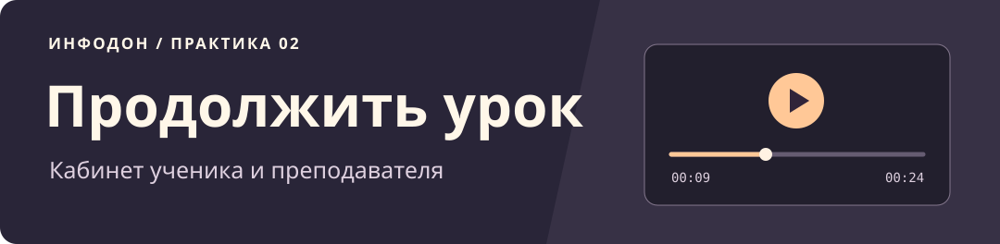

# Кабинет онлайн-школы

Вчера ученик смотрел урок с телефона и остановился на девятой секунде. Сегодня он вернулся. Как ему продолжить? А как преподаватель поймёт, кто уже занимается, а кто ещё не начинал?

Сделайте работающий прототип для этих двух людей. Сами решите, какие нужны экраны и как между ними ходить. Можно делать одному или вдвоём, на HTML/CSS/JS или другом знакомом стеке.

## Начать за несколько минут

1. Войдите в GitHub, нажмите **[Fork → Create fork](https://github.com/Shugar86/practice-online-school/fork)**. Копия появится в вашем аккаунте.
2. На странице **своего форка** нажмите **Code → Open with GitHub Desktop → Clone**. Или скопируйте адрес из **Code → HTTPS** и передайте его команде `git clone`.
3. В полученной папке откройте [index.html](index.html) двойным щелчком: данные и видео работают без установки зависимостей и без сервера.
4. Создайте ветку `practice/my-school`: в GitHub Desktop это **Current Branch → New Branch**, в терминале — `git switch -c practice/my-school`.

| В наборе | Для чего |
| --- | --- |
| [fixtures.js](fixtures.js) | Один курс, два урока, четыре вымышленных ученика. У Бориса уже есть прогресс, у Ани пока нет. |
| [lesson.mp4](media/lesson.mp4) | 24 секунды без звука, в кадре таймкод. Файл общий для обоих уроков: сохраняйте позицию отдельно для каждого ученика и урока. |

## Что показать

- **Ученик возвращается.** На экране шириной 390 px начните урок, закройте страницу примерно на 9-й секунде и откройте снова. Можно продолжить оттуда же. У другого ученика или в другом уроке эта позиция не появляется.
- **Доступ к курсу.** Покажите три случая: доступ есть, его не выдавали, срок истёк. Что увидит каждый ученик, если получит прямую ссылку на страницу урока? В демо можно переключать вымышленных пользователей.
- **Преподаватель видит результат.** Видно, у кого открыт курс, кто ещё не начал и кто какой урок смотрит. Покажите, как после просмотра меняются сведения преподавателя.

Для фронтенда достаточно имитации доступа и сохранения прогресса в браузере. Учебный MP4 открыт: скрытие плеера не защищает файл. Если есть бэкендер, можно дополнительно проверять доступ на сервере при выдаче самого видео. Тогда покажите, что запрос без действующего доступа файл не получает. Защита от записи экрана в задание не входит.

## Как сдать

Закоммитьте работу и отправьте ветку в свой форк (**Publish branch** или **Push origin** в GitHub Desktop). В Telegram пришлите ссылку на **свою ветку в форке или pull request**, как запустить результат и двухминутную запись экрана. ИИ можно использовать. От себя напишите пару предложений: что решили сделать именно так и почему.
